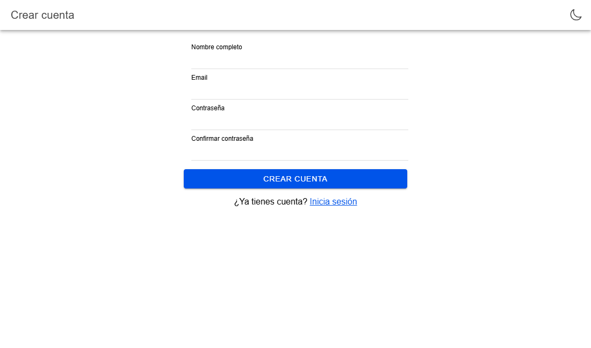
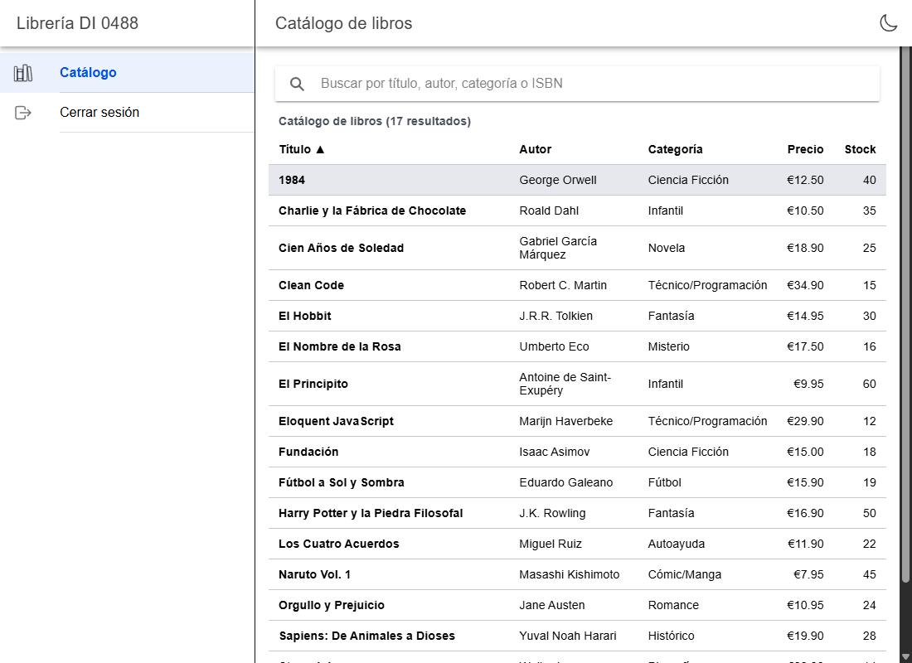
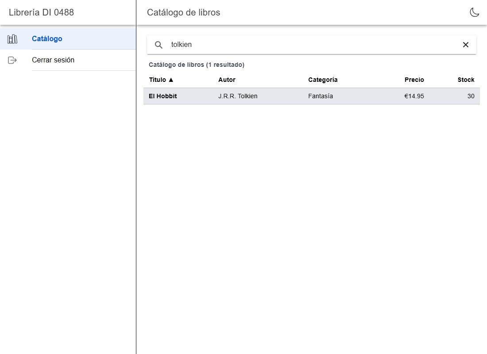
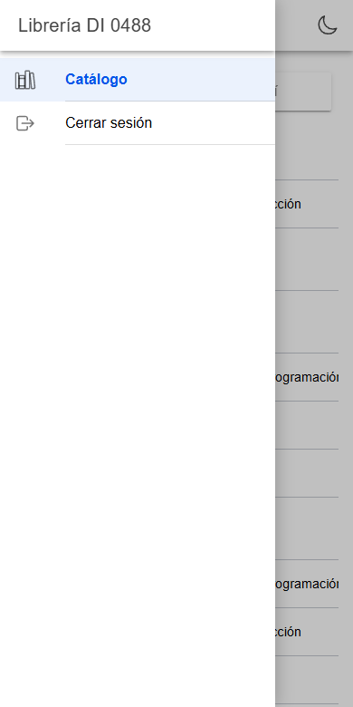
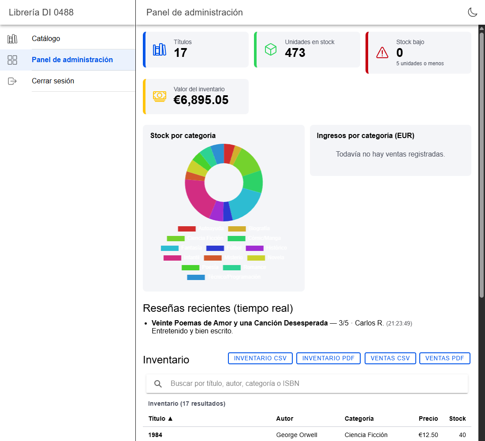
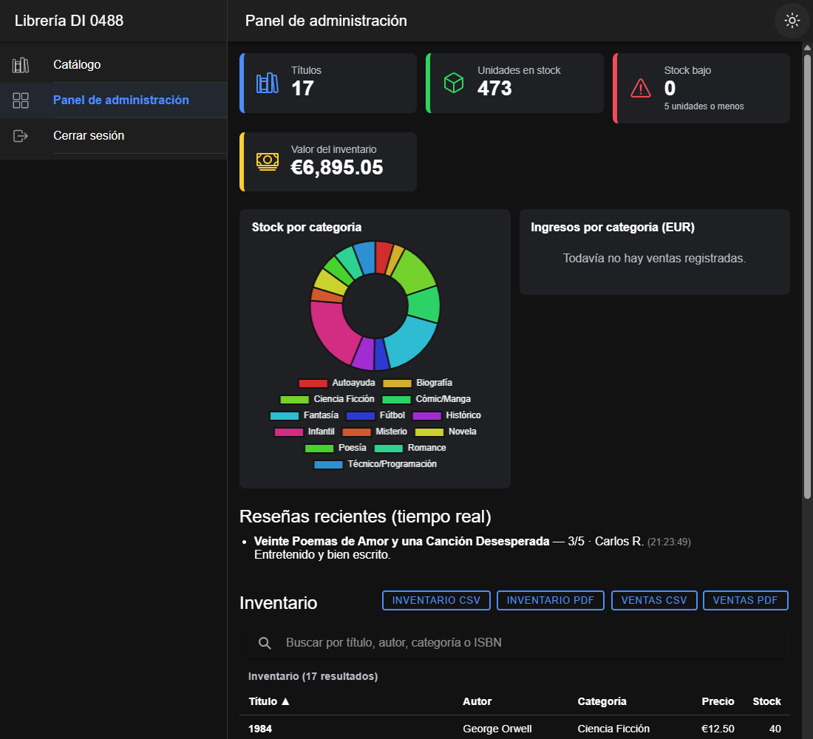

# Manual de usuario — Librería DI 0488

Aplicación web para consultar el catálogo de libros y, si eres administrador,
gestionar el inventario y consultar estadísticas. Funciona en ordenador, tableta y móvil.

## 1. Credenciales de prueba

| Perfil | Email | Contraseña | Qué puede hacer |
|---|---|---|---|
| Usuario estándar | `juan_libreria_usuario@gmail.com` | `Usuario123!` | Ver y buscar en el catálogo |
| Administrador | `juan_libreria_admin@gmail.com` | `Admin123!` | Todo lo anterior + Panel de administración |

## 2. Iniciar sesión

1. Abre la aplicación. Si no has entrado, verás la pantalla de **Iniciar sesión**.
2. Escribe tu email y tu contraseña y pulsa **Entrar**.
3. Si los datos no son correctos, aparece un mensaje en rojo y puedes volver a intentarlo.

Si intentas entrar a una página protegida sin haber iniciado sesión, la aplicación te lleva al
login y, al entrar, te devuelve a la página que querías ver.

## 3. Crear una cuenta

1. En el login, pulsa **Regístrate**.
2. Rellena nombre, email, contraseña (mínimo 6 caracteres) y su confirmación.
3. El email se comprueba al salir del campo: si ya existe, la aplicación te avisa.
4. Pulsa **Crear cuenta**.

Si has escrito datos en el formulario e intentas salir de la página, se te pregunta si quieres
descartarlos. Según la configuración del proyecto, puede que tengas que confirmar tu email antes
de poder entrar.

## 4. Catálogo de libros

Tras iniciar sesión se muestra el catálogo con título, autor, categoría, precio y stock.

- **Buscar:** escribe en el cuadro superior; se filtra por título, autor, categoría o ISBN.
- **Ordenar:** pulsa el nombre de una columna. Pulsa otra vez para invertir el orden. La flecha
  indica la columna y el sentido activos.
- **Seleccionar:** pulsa una fila (o usa el teclado con `Tab` y `Intro`) para marcar un libro.

## 5. Menú y navegación

En pantallas grandes el menú está siempre visible a la izquierda. En el móvil se abre con el
botón de las tres rayas, arriba a la izquierda.

- **Catálogo:** lista de libros.
- **Panel de administración:** solo aparece si eres administrador.
- **Cerrar sesión:** termina tu sesión y te lleva al login.

Si intentas abrir una sección para la que no tienes permiso verás la página **403 · Acceso
denegado**; si la dirección no existe, la página **404 · Página no encontrada**.

## 6. Panel de administración (solo administradores)

Muestra un resumen del negocio:

- **Tarjetas:** títulos, unidades en stock, libros con stock bajo (5 unidades o menos) y valor del
  inventario.
- **Gráficos circulares:** stock por categoría e ingresos por categoría. Si todavía no hay ventas,
  el gráfico de ingresos lo indica con un mensaje.
- **Reseñas recientes:** se van actualizando solas en tiempo real (datos de ejemplo).
- **Inventario:** la misma tabla del catálogo, con buscador y ordenación.

### Exportar informes

Sobre la tabla de inventario hay cuatro botones:

| Botón | Resultado |
|---|---|
| Inventario CSV / PDF | Lista de libros con autor, categoría, precio y stock |
| Ventas CSV / PDF | Lista de ventas con fecha, libro, cantidad y total |

El navegador descarga el archivo directamente. El CSV se abre con Excel o cualquier hoja de cálculo.

## 7. Modo oscuro y claro

El botón con forma de **luna** o **sol**, arriba a la derecha de cualquier página, cambia entre
modo claro y oscuro. La aplicación recuerda tu elección. La primera vez usa el modo de tu
dispositivo.

## 8. Accesibilidad

- Toda la aplicación se puede usar solo con el teclado (`Tab`, `Mayús+Tab`, `Intro`, `Espacio`),
  con el foco siempre visible.
- Las tablas y los gráficos incluyen descripciones para lectores de pantalla.
- El texto mantiene un contraste suficiente en modo claro y oscuro, y se puede ampliar con el zoom
  del navegador.
- Si tu sistema pide reducir animaciones, la aplicación las minimiza.

## 9. Problemas frecuentes

| Problema | Qué hacer |
|---|---|
| «Email o contraseña incorrectos» | Revisa mayúsculas y símbolos. Si te registraste hace poco, comprueba tu correo por si hay que confirmar la cuenta. |
| «Debes confirmar tu email» | Abre el mensaje de confirmación que recibiste y pulsa el enlace. |
| No veo el Panel de administración | Tu cuenta es de usuario estándar; solo los administradores lo ven. |
| El catálogo no carga | Comprueba tu conexión y recarga la página. |
| El gráfico de ingresos está vacío | Todavía no hay ventas registradas. |
