# Manual de usuario — Librería

**Librería** es una aplicación web para consultar un catálogo de libros y, si tienes
rol de administrador, ver estadísticas del negocio y descargar informes. Funciona en ordenador,
tableta y móvil, con modo claro y oscuro.

## Índice

1. [Cuentas de prueba](#1-cuentas-de-prueba)
2. [Iniciar sesión](#2-iniciar-sesión)
3. [Crear una cuenta](#3-crear-una-cuenta)
4. [Catálogo de libros](#4-catálogo-de-libros)
5. [Menú y navegación](#5-menú-y-navegación)
6. [Panel de administración](#6-panel-de-administración-solo-administradores)
7. [Modo oscuro y claro](#7-modo-oscuro-y-claro)
8. [Uso en el móvil](#8-uso-en-el-móvil)
9. [Accesibilidad](#9-accesibilidad)
10. [Problemas frecuentes](#10-problemas-frecuentes)

---

## 1. Cuentas de prueba

| Perfil | Email | Contraseña | Qué puede hacer |
|---|---|---|---|
| Usuario estándar | `juan_libreria_usuario@gmail.com` | `Usuario123!` | Ver, buscar, filtrar y consultar el detalle de los libros |
| Administrador | `juan_libreria_admin@gmail.com` | `Admin123!` | Todo lo anterior, más el Panel de administración |

Son cuentas creadas solo para probar la aplicación.

## 2. Iniciar sesión

1. Abre la aplicación. Si no has iniciado sesión, verás la pantalla **Bienvenido de nuevo**.
2. Escribe tu **email** y tu **contraseña**. El icono del ojo, a la derecha de la contraseña,
   permite verla u ocultarla.
3. Pulsa **Entrar**.

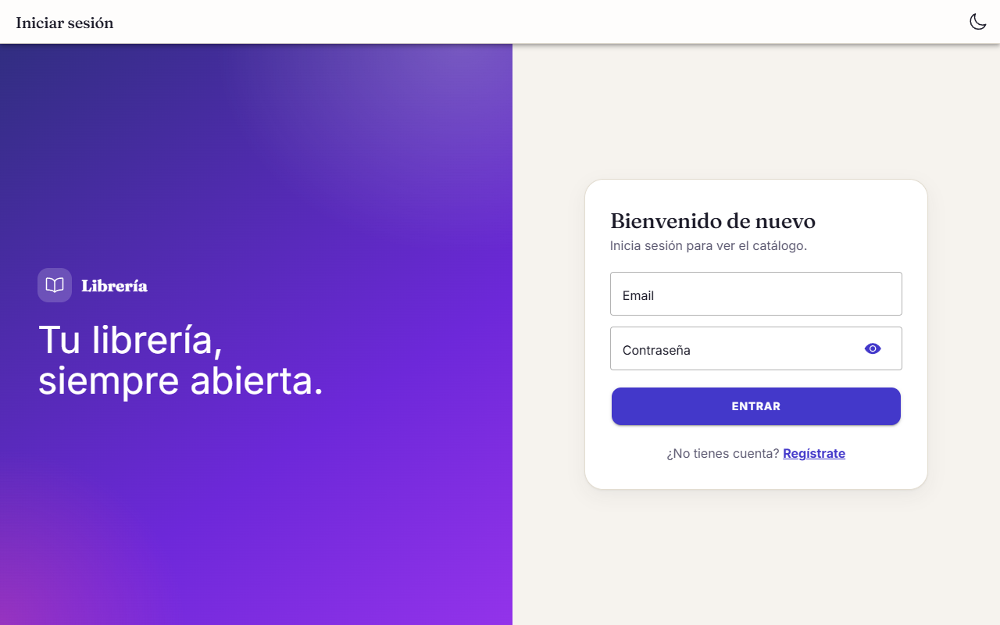

Si el email o la contraseña no son correctos, aparece un aviso en rojo y puedes volver a intentarlo.

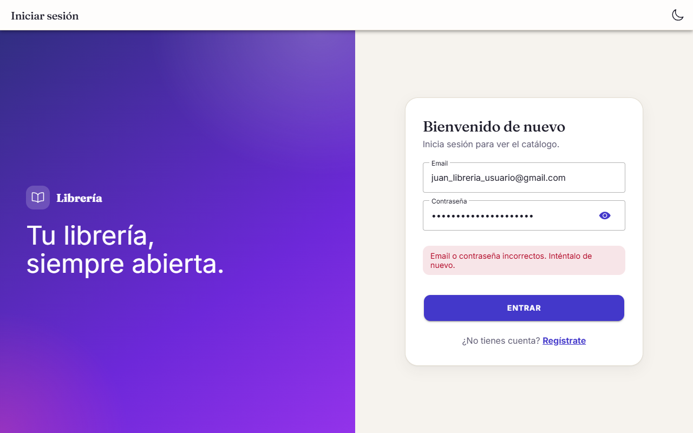

**Si intentas abrir una página protegida sin haber iniciado sesión** (por ejemplo, un enlace
directo al panel de administración), la aplicación te lleva al login y, una vez dentro, te devuelve
a la página que querías ver. Después de entrar siempre llegas a una pantalla a la que tienes acceso.

## 3. Crear una cuenta

1. En el login, pulsa **Regístrate**.
2. Rellena **nombre completo**, **email**, **contraseña** (mínimo 6 caracteres) y su **confirmación**.
3. Pulsa **Crear cuenta**.

La aplicación te avisa de los problemas mientras rellenas el formulario:

- Al salir del campo **Email**, comprueba si ya existe una cuenta con esa dirección y lo indica.
- Si las dos contraseñas no coinciden, se muestra el aviso bajo el segundo campo.

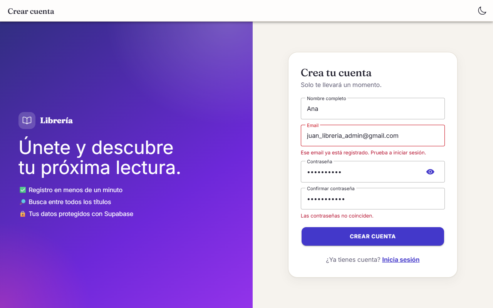

Las cuentas nuevas son de **usuario estándar**. Según la configuración del proyecto, puede que
tengas que confirmar tu email antes de poder iniciar sesión; en ese caso, abre el mensaje que
recibirás y pulsa el enlace.

Si has empezado a rellenar el formulario e intentas salir de la página, la aplicación te pregunta
si quieres descartar lo escrito.

## 4. Catálogo de libros

Al iniciar sesión llegas al **Catálogo**, un escaparate con todos los libros. Cada tarjeta muestra:

- la **portada**, con etiquetas de *Destacado* y de descuento (por ejemplo, **-10 %**);
- la **categoría**, el **título** y el **autor**;
- la **valoración** (★) y la **disponibilidad**: *En stock*, *Últimas N uds.* (5 o menos) o *Agotado*;
- el **precio final**, con el precio original tachado cuando hay descuento.

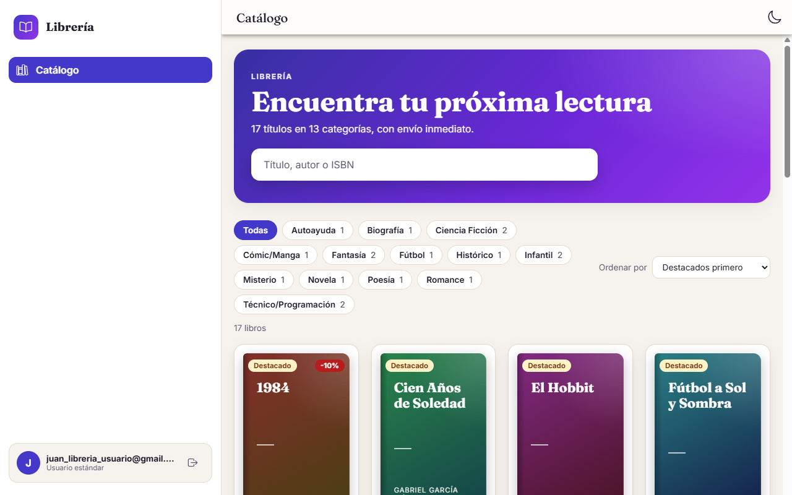

### Buscar, filtrar y ordenar

- **Buscar:** escribe en el cuadro del banner. Se filtra al instante por título, autor,
  categoría o ISBN.
- **Filtrar por categoría:** pulsa una etiqueta (junto a cada una aparece cuántos libros tiene).
  Pulsa **Todas**, o la misma etiqueta otra vez, para quitar el filtro.
- **Ordenar:** el selector **Ordenar por** ofrece *Destacados primero*, *Título (A-Z)*,
  *Precio: menor a mayor*, *Precio: mayor a menor* y *Mejor valorados*.

Sobre la rejilla se indica cuántos libros coinciden. Si ninguno coincide, la aplicación te avisa.

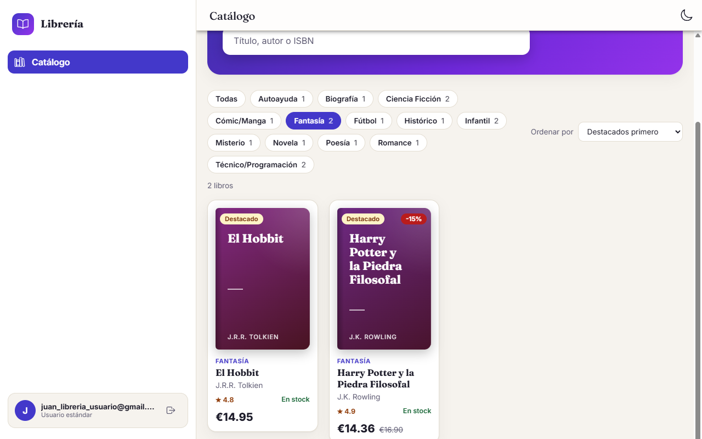

### Ver el detalle de un libro

Pulsa una tarjeta (o, con el teclado, ponte sobre ella con `Tab` y pulsa `Intro`) para abrir su
ficha con la descripción, la editorial, el año, las páginas, el idioma, el ISBN y las unidades
disponibles. Se cierra con la **✕** o con la tecla `Esc`.

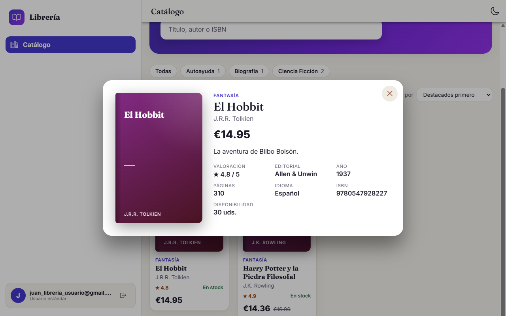

## 5. Menú y navegación

En pantallas grandes, el menú está siempre visible a la izquierda. Contiene:

- **Catálogo:** el escaparate de libros. La sección en la que estás aparece resaltada.
- **Panel de administración:** solo aparece si eres administrador.
- **Tarjeta de usuario** (abajo): tu nombre, tu rol (*Usuario estándar* o *Administrador*) y el
  botón de salida para **cerrar sesión**, que te lleva de nuevo al login.

Si un usuario estándar intenta abrir el panel de administración escribiendo su dirección, verá la
página **403 · Acceso denegado**. Si la dirección no existe, verá la página **404 · Página no
encontrada**. En ambas hay un botón para volver al catálogo.

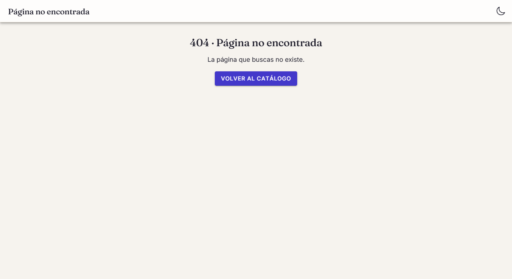

## 6. Panel de administración (solo administradores)

Se abre desde el menú con **Panel de administración**. Resume el estado de la librería:

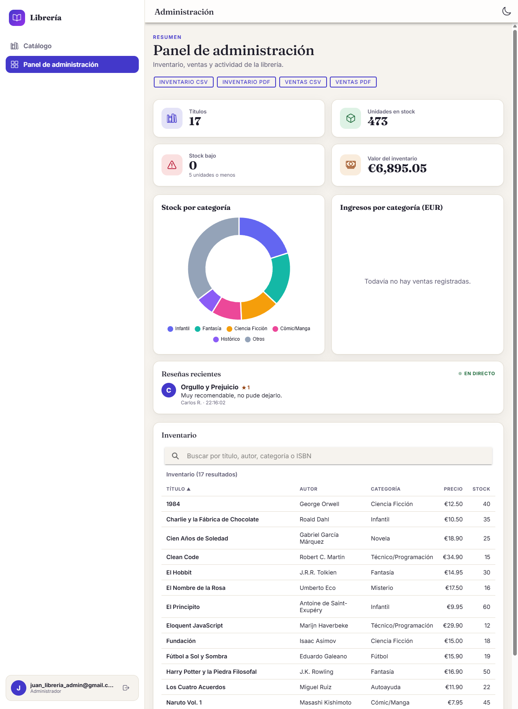

| Zona | Qué muestra |
|---|---|
| **Tarjetas** | Número de títulos, unidades en stock, títulos con **stock bajo** (5 unidades o menos) y **valor del inventario** (precio de lista por unidades en stock) |
| **Stock por categoría** | Gráfico circular con las 5 categorías con más stock; el resto se agrupa en *Otros* |
| **Ingresos por categoría** | Gráfico circular con los ingresos de las ventas registradas, con el mismo criterio. Si todavía no hay ventas, lo indica con un mensaje |
| **Reseñas recientes** | Opiniones de lectores que se añaden solas, «en directo». Son datos de ejemplo generados por la propia aplicación |
| **Inventario** | Tabla con todos los libros. Tiene buscador y se puede ordenar pulsando el nombre de cada columna (la flecha ▲/▼ indica el sentido) |

### Exportar informes

En la cabecera del panel hay cuatro botones. Al pulsarlos, el navegador descarga el archivo.

| Botón | Archivo | Contenido |
|---|---|---|
| Inventario CSV | `inventario.csv` | Título, autor, categoría, precio y stock de cada libro |
| Inventario PDF | `inventario.pdf` | Lo mismo, como informe con título y fecha de generación |
| Ventas CSV | `ventas.csv` | Fecha, libro, cantidad, precio unitario y total de cada venta |
| Ventas PDF | `ventas.pdf` | Lo mismo, como informe con título y fecha de generación |

Los CSV usan el punto y coma (`;`) como separador y se abren directamente en Excel con los
acentos correctos. **Si todavía no hay ventas registradas, los informes de ventas se generan solo
con la fila de cabeceras.**

## 7. Modo oscuro y claro

El botón con forma de **luna** (o **sol**) está en la esquina superior derecha de todas las
páginas, también en el login y el registro. Cambia entre modo claro y modo oscuro.

- La primera vez, la aplicación usa el modo que tenga tu dispositivo.
- Después **recuerda tu elección** aunque cierres el navegador.
- Los gráficos se adaptan al cambiar de modo.

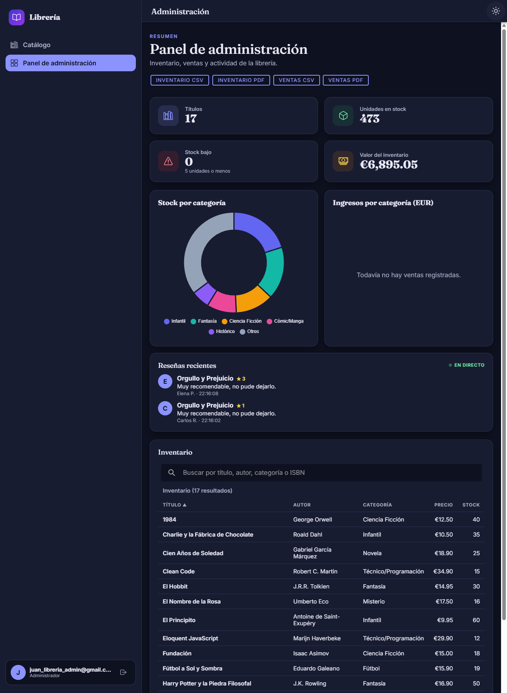

## 8. Uso en el móvil

La aplicación se adapta al ancho de la pantalla:

- El catálogo muestra dos libros por fila, y las categorías se desplazan en una sola fila hacia los lados.
- El menú se abre con el botón de las **tres rayas**, arriba a la izquierda.
- En el panel de administración, las tarjetas y los gráficos se apilan en una columna, y la tabla
  de inventario se desplaza hacia los lados.

| Catálogo | Menú | Panel de administración |
|---|---|---|
| 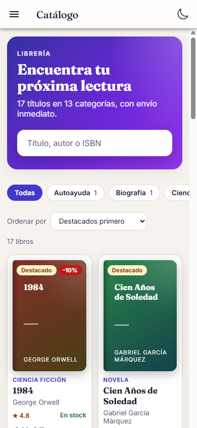 | 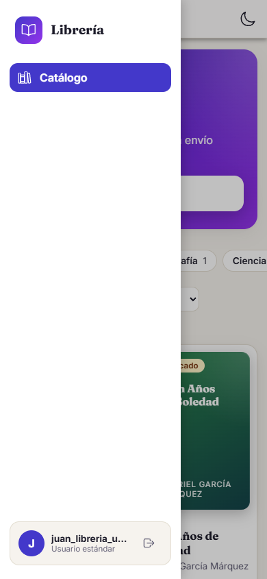 | 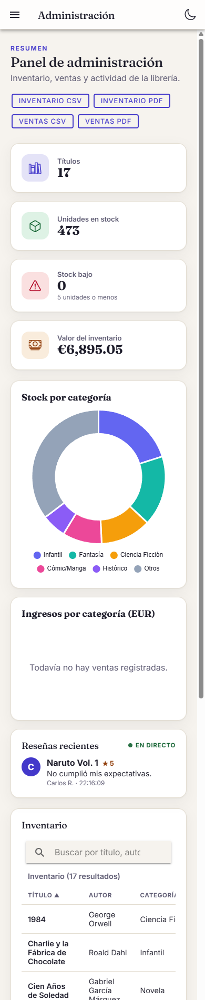 |

## 9. Accesibilidad

La aplicación obtiene **100 puntos en Accesibilidad y 100 en Buenas prácticas** en las auditorías
de Lighthouse (informes en [`docs/lighthouse/`](../lighthouse/README.md)). En la práctica:

- **Teclado:** todo se puede usar solo con el teclado (`Tab` y `Mayús+Tab` para moverte, `Intro` o
  `Espacio` para activar, `Esc` para cerrar la ficha de un libro). El elemento enfocado siempre
  tiene un contorno visible.
- **Lectores de pantalla:** los campos tienen etiqueta, los errores se anuncian, las tablas tienen
  título y los gráficos incluyen una descripción con sus datos.
- **Contraste y zoom:** los colores mantienen contraste suficiente en claro y en oscuro, y la
  página admite ampliarse con el zoom del navegador.
- **Movimiento:** si tu sistema pide reducir las animaciones, la aplicación las minimiza.

## 10. Problemas frecuentes

| Problema | Qué hacer |
|---|---|
| «Email o contraseña incorrectos» | Revisa mayúsculas, símbolos y el icono del ojo para ver lo que escribes. Si te registraste hace poco, comprueba si debes confirmar tu correo. |
| «Debes confirmar tu email antes de iniciar sesión» | Abre el mensaje de confirmación que recibiste al registrarte y pulsa el enlace. |
| «Ese email ya está registrado» al crear la cuenta | Ya existe una cuenta con esa dirección. Pulsa **Inicia sesión**. |
| No veo el Panel de administración | Tu cuenta es de usuario estándar; solo los administradores lo ven. |
| Me aparece «403 · Acceso denegado» | No tienes permiso para esa sección. Vuelve al catálogo desde el botón de la página. |
| El catálogo no carga | Comprueba tu conexión y recarga la página. |
| El gráfico de ingresos está vacío | Todavía no hay ventas registradas. |
| El informe de ventas solo tiene las cabeceras | Por la misma razón: no hay ventas todavía. |
